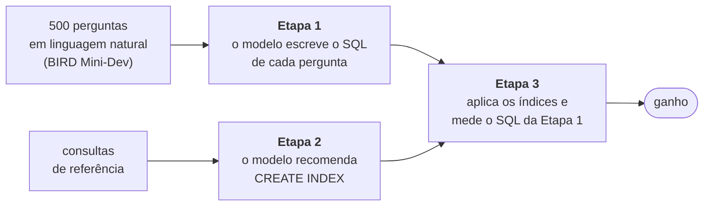

<div align="center">

# Avaliação de Modelos de Linguagem na Recomendação de Índices em Sistemas de Gerência de Banco de Dados

**Avaliação de cinco LLMs recomendando índices para SQLite, PostgreSQL e MariaDB**

*Evaluating Large Language Models for Index Recommendation across Database Management Systems*


-8A2BE2)

Trabalho de Conclusão de Curso · Bacharelado em Sistemas de Informação · Universidade Federal Fluminense<br>
Rafael Langsch Caheté Rêgo · Orientação: Prof. Daniel Cardoso Moraes de Oliveira

</div>

---

## Em uma frase

Cinco modelos de linguagem recomendam índices para 11 bancos reais em três
SGBDs, e mede-se quanto esses índices aceleram as consultas que o próprio modelo
escreveu. **Os índices funcionam, mas o ganho depende mais do SGBD do que do
modelo.**

## Principais resultados

- **Os índices são aplicáveis:** de 90,4% a 98,8% dos `CREATE INDEX`
  recomendados executam sem erro. As falhas se concentram no MariaDB.
- **Todos reduzem o tempo da carga, mas o ganho acompanha o SGBD:** a mediana vai
  de 2,58× a 4,16× no SQLite e fica entre 1,22× e 1,68× no PostgreSQL e no MariaDB.
- **Ganho e acurácia não andam juntos:** a ordem dos modelos por ganho não
  acompanha a ordem por acurácia.
- **Avaliar só em SQLite superestima o *text-to-SQL*:** nos cinco modelos, a
  acurácia no SQLite supera a média dos outros dois sistemas, por 6,4 a 8,7 pontos
  percentuais.

## Como o experimento funciona



| Etapa | O que acontece | O que mede |
|---|---|---|
| **1. Composição da carga de trabalho** | O modelo traduz as 500 perguntas para SQL (*text-to-SQL*) | Acurácia de execução, correspondência exata, latência, plano |
| **2. Recomendação de índices** | O modelo recebe o esquema e as consultas de referência de cada banco e devolve `CREATE INDEX` | Índices aplicáveis e ganho sobre a referência |
| **3. Efeito sobre a carga gerada** | Os índices são criados e as consultas da Etapa 1 rodam de novo, sem chamar o modelo | Ganho sobre a carga que o modelo gerou |

São 5 modelos × 3 SGBDs = **15 combinações** e **7.500 questões** medidas.

## Resultados

**Ganho mediano dos índices** (latência antes ÷ depois, sobre a carga gerada)

| Modelo | Índices aplicáveis | SQLite | PostgreSQL | MariaDB |
|---|---:|---:|---:|---:|
| Claude Sonnet 5 | 98,6% | 3,52× | **1,68×** | **1,65×** |
| Gemini 3.1 Flash Lite | 96,4% | 2,58× | 1,40× | 1,22× |
| Qwen 3.8 27B | 93,9% | 3,15× | 1,26× | 1,24× |
| GPT-5.6 Luna | **98,8%** | **4,16×** | 1,55× | 1,43× |
| DeepSeek V4 Flash | 90,4% | 3,16× | 1,62× | 1,37× |

**Acurácia de execução na Etapa 1** (500 questões por célula)

| Modelo | SQLite | PostgreSQL | MariaDB |
|---|---:|---:|---:|
| Claude Sonnet 5 | **67,0%** | **58,6%** | **58,0%** |
| Gemini 3.1 Flash Lite | 61,2% | 55,4% | 52,6% |
| Qwen 3.8 27B | 53,4% | 47,4% | 46,6% |
| GPT-5.6 Luna | 53,8% | 46,4% | 46,0% |
| DeepSeek V4 Flash | 52,4% | 43,8% | 44,4% |

Todos os números acima estão no artigo e são conferidos pelo script da seção a
seguir.

---

## Conferir os números do artigo (5 minutos, sem custo)

Todo número citado no TCC é recalculado a partir dos arquivos brutos das
execuções. Não é preciso chave de API nem banco de dados.

```bash
git clone https://github.com/Langsch/text2sql-benchmark.git
cd text2sql-benchmark
uv venv && uv pip install -e .

# arquivos brutos das execuções (7 MB)
curl -LO https://github.com/Langsch/text2sql-benchmark/releases/download/v1.0-tcc/resultados.tar.gz
curl -LO https://github.com/Langsch/text2sql-benchmark/releases/download/v1.0-tcc/resultados.sha256
sha256sum -c resultados.sha256 && tar -xzf resultados.tar.gz

.venv/bin/python analise/reproduzir.py
```

Saída esperada:

```
Arquivos íntegros: sim
Afirmações: 125/125 coincidem
```

O script confere o SHA-256 de cada arquivo usado e regenera
[`analise/saida/numeros_do_artigo.md`](analise/saida/numeros_do_artigo.md). Esse
relatório lista cada afirmação do artigo ao lado do valor recalculado. Já sem
baixar nada, as tabelas derivadas estão em [`analise/saida/csv/`](analise/saida/csv/).
Detalhes em [`analise/README.md`](analise/README.md).

## Rodar o experimento do zero

Requer Python 3.11+, [`uv`](https://docs.astral.sh/uv/), Docker e chaves de API
(Anthropic e [OpenRouter](https://openrouter.ai/)).

```bash
uv venv && uv pip install -e ".[dev]"
cp .env.example .env                      # preencha as chaves
.venv/bin/python download_dataset.py      # baixa o BIRD Mini-Dev
docker compose up -d                      # sobe PostgreSQL 17 e MariaDB 11
./scripts/setup_databases.sh <pasta do minidev>

# as três etapas de uma combinação
.venv/bin/python cli.py pipeline --model <modelo> --sgbd sqlite|postgresql|mariadb
```

Testes: `.venv/bin/python -m pytest -q`. Passo a passo do OpenRouter e custos:
[`docs/runbook_openrouter.md`](docs/runbook_openrouter.md).

> As respostas dos modelos não são determinísticas, então uma nova execução dá
> números próximos, mas não idênticos. A conferência exata é a da seção anterior.

---

<details>
<summary><b>Configuração dos modelos</b></summary>

| Modelo | Acesso | Provedor fixado | Raciocínio |
|---|---|---|---|
| Claude Sonnet 5 | API nativa da Anthropic | — | padrão do modelo (adaptativo) |
| Gemini 3.1 Flash Lite | OpenRouter | google-ai-studio | desabilitado |
| Qwen 3.8 27B | OpenRouter | chutes (fp8) | desabilitado |
| GPT-5.6 Luna | OpenRouter | openai | desabilitado |
| DeepSeek V4 Flash | OpenRouter | novita (fp8) | desabilitado |

Todos recebem o mesmo *prompt*, *zero-shot*, mudando só o nome do SGBD. Nenhum
recebeu parâmetro de temperatura. O provedor que atendeu foi gravado em cada
chamada: nas Etapas 1 e 2, todas as 6.132 chamadas via OpenRouter foram
atendidas pelo provedor fixado.

</details>

<details>
<summary><b>Limitações</b></summary>

- As respostas não são determinísticas: não há configuração de temperatura
  comum aos provedores.
- O Claude Sonnet 5 rodou com o raciocínio adaptativo padrão, e os demais com
  raciocínio desabilitado. A API da Anthropic permitiria desligá-lo; isso não
  foi feito na execução. Na Etapa 2, os tokens cobrados mostram que ele de
  fato raciocinou (mediana de 1.549 a 3.580 tokens de saída por chamada, para
  respostas de cerca de 900 a 1.000); ver §10 do
  [relatório de conferência](analise/saida/numeros_do_artigo.md).
- A recomendação sai de uma única interação, sem orçamento de armazenamento e
  sem refinamento iterativo. Não se mede o teto de capacidade dos modelos.
- A acurácia de execução segue o critério do BIRD: compara conjuntos de linhas,
  ignorando ordem e duplicatas.

</details>

<details>
<summary><b>Disponibilidade dos dados</b></summary>

| Conteúdo | Onde |
|---|---|
| Tabelas agregadas e uma linha por questão (CSV) | [`analise/saida/csv/`](analise/saida/csv/), neste repositório |
| Arquivos brutos de todas as execuções (JSON: *prompt* exato, SQL gerado, resposta íntegra do modelo na Etapa 2, plano de execução, provedor que atendeu) | `resultados.tar.gz` na release [`v1.0-tcc`](https://github.com/Langsch/text2sql-benchmark/releases/tag/v1.0-tcc) · DOI Zenodo: *a preencher* |
| BIRD Mini-Dev | Não redistribuído; baixe na fonte com `download_dataset.py` |

</details>

<details>
<summary><b>O que o repositório tem além do artigo</b></summary>

O código e a documentação registram mais do que o artigo usa. Nada disto
sustenta afirmações do artigo:

- **Análises complementares** em [`docs/resultados_matriz_completa.md`](docs/resultados_matriz_completa.md):
  Exact Match, erros por tipo, acurácia por dificuldade e o registro dos
  defeitos encontrados e corrigidos durante a rodada.
- **Conectores de outros provedores** (`llm/openai_connector.py`,
  `google_connector.py`, `groq_connector.py`), de fases anteriores do projeto.
  A rodada do artigo usou só a API da Anthropic e o OpenRouter.
- **Opção de rodar sem *evidence*** (`BIRD_USE_EVIDENCE=false`). Todas as rodadas
  do artigo incluíram o conhecimento de domínio.
- **Primeiro ensaio de recomendação de índices**, de junho de 2026, com outros
  modelos: [`docs/historico_indices_junho.md`](docs/historico_indices_junho.md).

</details>

<details>
<summary><b>Estrutura do repositório</b></summary>

```
analise/        conferência dos números do artigo (manifesto, script, relatório, CSVs)
cli.py          comandos: pipeline (as três etapas), run, index, revalidate,
                compare, smoke, providers e relatórios
docs/           arquitetura, resultados detalhados, runbook do OpenRouter
src/text2sql_benchmark/
  dataset/      leitura do BIRD
  prompt/       prompts de text-to-SQL e de recomendação de índices
  llm/          conectores (Anthropic, OpenRouter e outros)
  db/           conectores SQLite, PostgreSQL e MariaDB; isolamento dos índices
  metrics/      acurácia de execução, exact match, planos, latência
  runner/       Etapas 1, 2 e 3
  report/       relatórios por modelo e comparativo
tests/          testes unitários
```

Decisões de projeto: [`docs/arquitetura.md`](docs/arquitetura.md).

</details>

## Referências do conjunto de dados

- LI, J. et al. **Can LLM Already Serve as a Database Interface? A BIg Bench
  for Large-Scale Database Grounded Text-to-SQLs.** In: *Advances in Neural
  Information Processing Systems 36 (NeurIPS 2023), Datasets and Benchmarks
  Track*, 2023.
- BIRD-BENCH. **BIRD Mini-Dev: A Compact Development Set for Text-to-SQL
  Evaluation.** 2024. Disponível em: <https://github.com/bird-bench/mini_dev>.
